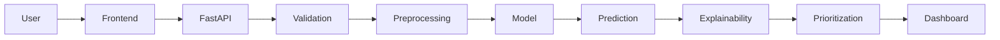
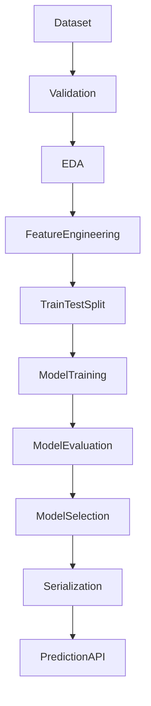
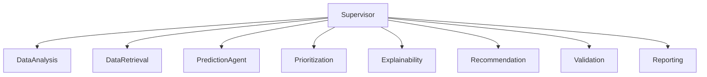
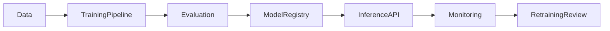

# Retail Sales Opportunity Propensity Classification

This project builds a complete retail sales opportunity propensity classification system using a synthetic retail dataset, a scikit-learn classification model, a FastAPI backend, and a lightweight Next.js dashboard. It is designed to help sales teams prioritize leads and opportunities based on predicted probability of conversion.

## Business problem

Retail sales teams often spend time on low-probability opportunities while missing high-value conversion possibilities. This project provides a working predictive classification pipeline that estimates the probability that an opportunity will convert, prioritizes high-potential records, and explains which features contribute most to the predicted outcome.

## Objectives

- Validate and process retail sales opportunity data
- Generate or load explanatory retail feature sets
- Train and compare classification models
- Produce conversion probabilities and priority labels
- Serve results through a REST API
- Keep the system deployable locally and in the cloud

## Dataset description

The project uses a clear synthetic retail opportunity dataset when no uploaded CSV is available. It includes fields such as customer segment, region, product category, product interest, purchase frequency, average order value, sales channel, engagement signals, opportunity age, and conversion label.

The target column is `converted` with values:

- `1` = Converted
- `0` = Not converted

## Data quality and validation

The data pipeline includes validation checks for:

- missing values
- duplicate rows
- empty dataset detection
- target column presence
- basic class distribution review
- categorical and numerical column detection

## Feature engineering

The model uses features such as:

- `customer_segment`
- `region`
- `product_category`
- `product_interest`
- `previous_purchases`
- `purchase_frequency`
- `avg_order_value`
- `sales_channel`
- `lead_source`
- `interactions`
- `days_since_last_interaction`
- `discount_offered`
- `opportunity_age`
- `historical_sales_value`
- `previous_conversion_history`
- `opportunity_stage`
- `follow_up_status`

The pipeline imputes missing values and one-hot encodes categorical columns using a `ColumnTransformer` so training and inference remain consistent.

## Model selection

The default model is a `LogisticRegression` classifier with class balancing. The project structure is set up so additional models such as random forest or XGBoost can be inserted into the training flow.

## Evaluation metrics

The system calculates:

- accuracy
- precision
- recall
- F1 score
- ROC-AUC
- PR-AUC
- confusion matrix
- classification report

## Prediction workflow

1. Data validation
2. Feature preprocessing
3. Model prediction
4. Probability output
5. Priority assignment
6. Explanation generation
7. Prediction persistence in SQLite

## Opportunity prioritization

Priority is assigned from the output probability:

- High: probability >= 0.70
- Medium: probability >= 0.40 and < 0.70
- Low: probability < 0.40

This preserves a deterministic and explainable prioritization logic.

## Explainability

The explainability layer ranks the most influential features by absolute contribution and returns them as part of the reasoning for a prediction. This is based on actual model coefficients rather than fabricated narrative output.

## Technology stack

- Python
- FastAPI
- Pydantic
- Pandas / NumPy
- Scikit-learn
- Joblib
- SQLite
- Next.js
- TypeScript
- Recharts

## Project folder structure

```text
.
├── backend/
│   ├── app/
│   ├── data/
│   ├── tests/
│   ├── __init__.py
│   ├── data_loader.py
│   ├── database.py
│   ├── evaluate.py
│   ├── explainability.py
│   ├── model_registry.py
│   ├── predict.py
│   ├── preprocessing.py
│   ├── train.py
│   └── validation.py
├── frontend/
│   ├── app/
│   ├── package.json
│   └── tsconfig.json
├── .env.example
├── .gitignore
├── Dockerfile
├── README.md
├── docker-compose.yml
├── requirements.txt
└── pytest.ini
```

## Installation

Create a virtual environment and install Python dependencies:

```bash
python -m venv .venv
source .venv/bin/activate
python -m pip install --upgrade pip
pip install -r requirements.txt
```

Frontend dependencies are installed separately:

```bash
cd frontend
npm install
```

## Environment variables

Use the example file:

```bash
cp .env.example .env
```

Available settings include the API host, port, and model directory.

## Train the model

```bash
python -c "from backend.data_loader import generate_synthetic_data; from backend.train import train_model; df = generate_synthetic_data(n_rows=2000, random_state=42); print(train_model(df)['metrics'])"
```

## Run predictions

The backend starts with:

```bash
uvicorn backend.app.main:app --host 0.0.0.0 --port 8000
```

The endpoint is:

```bash
curl -X POST http://localhost:8000/api/predict \
  -H 'Content-Type: application/json' \
  -d '{"opportunity_id":"OPP-1001","customer_segment":"VIP","region":"East","product_category":"Electronics","product_interest":"High","previous_purchases":7,"purchase_frequency":4.1,"avg_order_value":500.0,"sales_channel":"Online","lead_source":"Website","sales_rep":"REP-09","interactions":12,"days_since_last_interaction":15,"discount_offered":0.08,"opportunity_age":30,"historical_sales_value":4200.0,"previous_conversion_history":2,"opportunity_stage":"Proposal","follow_up_status":"Warm"}'
```

## Launch the dashboard

```bash
cd frontend
npm run dev
```

Then open:

```text
http://localhost:3000
```

## API documentation

FastAPI automatically exposes OpenAPI docs at:

- http://localhost:8000/docs
- http://localhost:8000/redoc

## Testing

Run the project tests:

```bash
pytest -q
```

## MLOps and monitoring

This project includes the following lifecycle elements:

- reproducible data generation
- preprocessing consistent across train/inference
- trained artifact persistence via `joblib`
- model metrics logging to structured responses
- SQLite prediction storage for traceability
- straightforward model versioning entry points

## Docker instructions

```bash
docker build -t retail-sales-propensity .
docker run -p 8000:8000 retail-sales-propensity
```

Or use Docker Compose:

```bash
docker-compose up --build
```

## Deployment

The project is prepared for local execution and can be adapted for cloud hosting. The backend is deployment-ready for containers, and the frontend is structured as a standard Next.js app for Vercel deployment.

## Limitations

- The dataset is synthetic by default because no live product CSV was provided.
- The current example model is a benchmark logistic regression baseline.
- More advanced models and drift monitoring can be added as the data grows.

## Future enhancements

- add a richer PostgreSQL-backed persistence layer
- train a more advanced tree-based model with hyperparameter tuning
- add a real agentic workflow layer with LangGraph
- add MLflow experiment tracking in a production environment
- add feature drift and model performance monitoring dashboards

## Architecture diagrams








